# AI-chan Character Design Sheets

[简体中文](README.md) · **English**

This collection turns illustrations of personified AI models and assistants into landscape reference sheets. Each sheet brings together front, left-side, and back views along with expressions, outfits, props, and accessories.

[Character Gallery](#character-gallery) · [Star History](#star-history) · [Assets and Workflow](#assets-and-workflow) · [Credits and License](#credits-and-license)

## Character Gallery

The gallery includes 19 entries and 20 sheets. Select a thumbnail for a larger preview or a character name for full-resolution tiles and production notes.

<table width="100%">
<tr>
<td width="50%" align="center" valign="top">
<a href="设定图/01_智谱GLM娘_阔耳狐娘/完整设定图_浏览预览.jpg">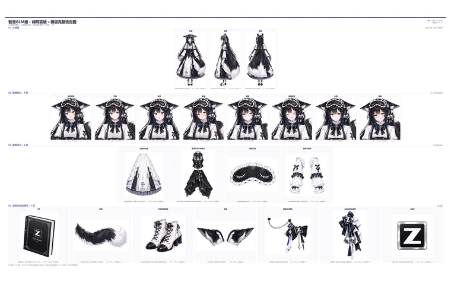</a> 
<strong><a href="设定图/01_智谱GLM娘_阔耳狐娘/">Zhipu GLM-chan</a></strong> 
01 · Wide-eared fox girl
</td>
<td width="50%" align="center" valign="top">
<a href="设定图/02_GPT娘_白龙娘/完整设定图_浏览预览.jpg">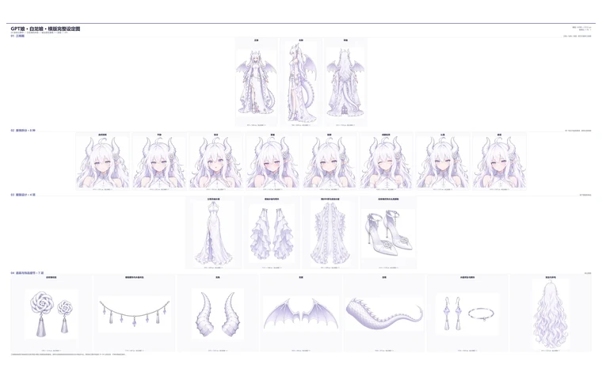</a> 
<strong><a href="设定图/02_GPT娘_白龙娘/">GPT-chan</a></strong> 
02 · White dragon girl
</td>
</tr>
<tr>
<td width="50%" align="center" valign="top">
<a href="设定图/03_DeepSeek娘_鲸鱼娘/完整设定图_浏览预览.jpg">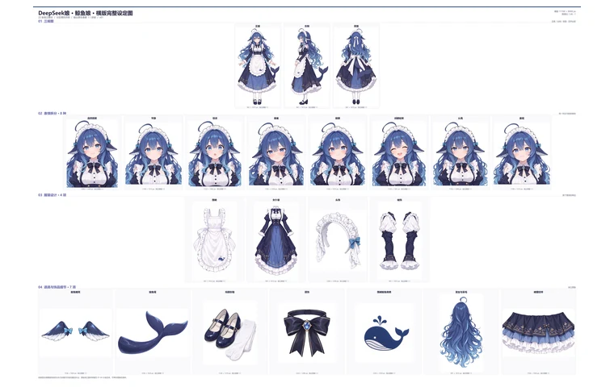</a> 
<strong><a href="设定图/03_DeepSeek娘_鲸鱼娘/">DeepSeek-chan</a></strong> 
03 · Whale girl
</td>
<td width="50%" align="center" valign="top">
<a href="设定图/04_文心一言娘/完整设定图_浏览预览.jpg">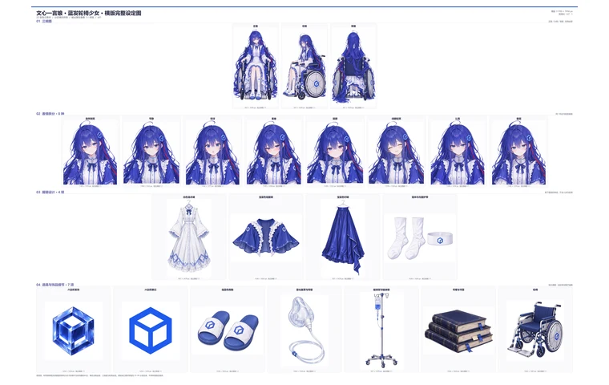</a> 
<strong><a href="设定图/04_文心一言娘/">ERNIE Bot-chan</a></strong> 
04 · Blue-haired wheelchair user
</td>
</tr>
<tr>
<td width="50%" align="center" valign="top">
<a href="设定图/05_通义千问娘_Qwen/完整设定图_浏览预览.jpg">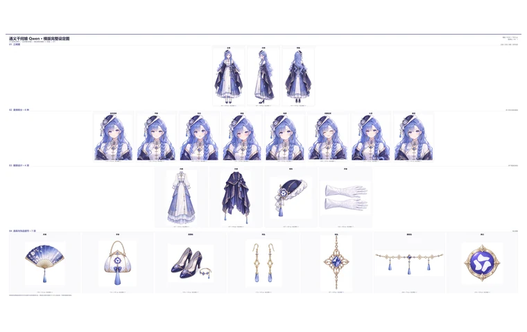</a> 
<strong><a href="设定图/05_通义千问娘_Qwen/">Qwen-chan</a></strong> 
05 · Tongyi Qianwen
</td>
<td width="50%" align="center" valign="top">
<a href="设定图/06_Kimi娘_Moonshot/完整设定图_浏览预览.jpg">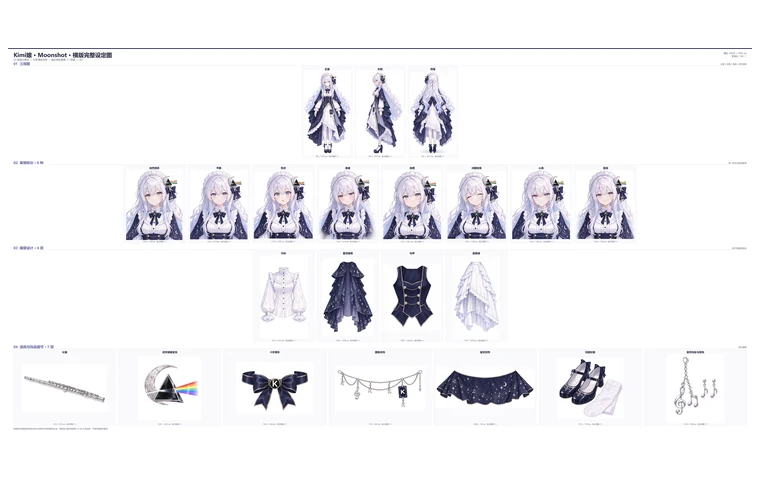</a> 
<strong><a href="设定图/06_Kimi娘_Moonshot/">Kimi-chan</a></strong> 
06 · Moonshot AI
</td>
</tr>
<tr>
<td width="50%" align="center" valign="top">
<a href="设定图/07_豆包Seed娘/完整设定图_浏览预览.jpg">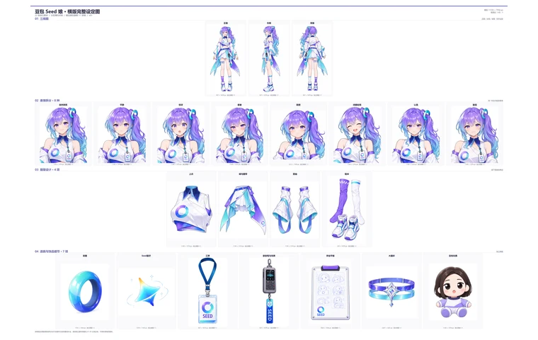</a> 
<strong><a href="设定图/07_豆包Seed娘/">Doubao Seed-chan</a></strong> 
07 · High purple ponytail
</td>
<td width="50%" align="center" valign="top">
<a href="设定图/08_MiniMax娘_海螺AI/完整设定图_浏览预览.jpg">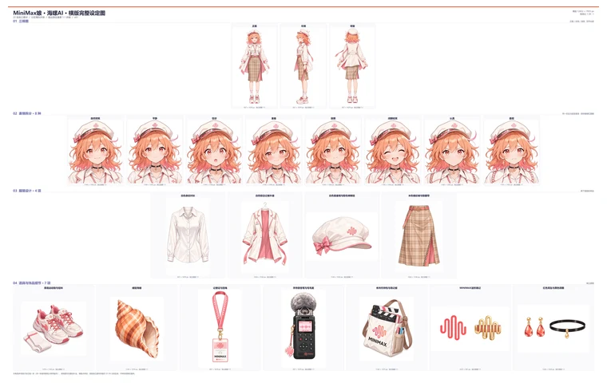</a> 
<strong><a href="设定图/08_MiniMax娘_海螺AI/">MiniMax-chan</a></strong> 
08 · Hailuo AI
</td>
</tr>
<tr>
<td width="50%" align="center" valign="top">
<a href="设定图/09_Grok娘_xAI/完整设定图_浏览预览.jpg">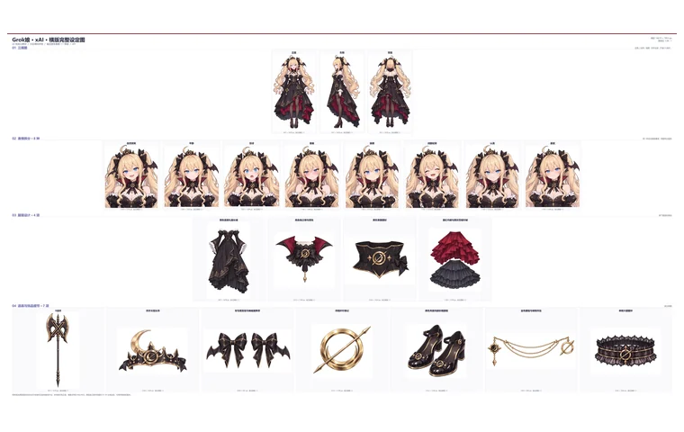</a> 
<strong><a href="设定图/09_Grok娘_xAI/">Grok-chan</a></strong> 
09 · Blonde vampire
</td>
<td width="50%" align="center" valign="top">
<a href="设定图/10_Gemini娘/完整设定图_浏览预览.jpg">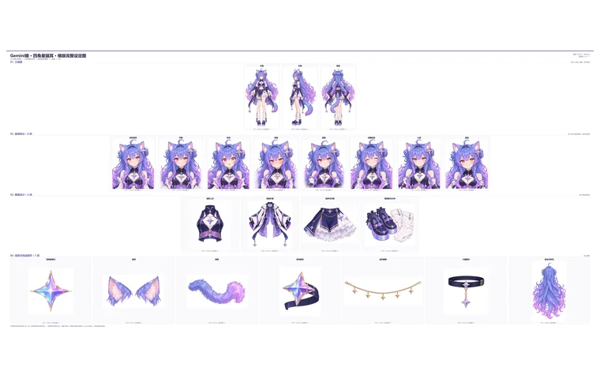</a> 
<strong><a href="设定图/10_Gemini娘/">Gemini-chan</a></strong> 
10 · Four-point stars and cat ears
</td>
</tr>
<tr>
<td width="50%" align="center" valign="top">
<a href="设定图/11_Claude娘_Anthropic/完整设定图_浏览预览.jpg">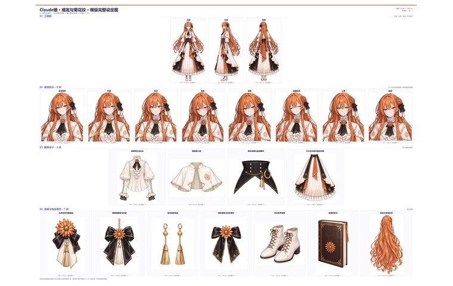</a> 
<strong><a href="设定图/11_Claude娘_Anthropic/">Claude-chan</a></strong> 
11 · Orange hair and chrysanthemum motifs
</td>
<td width="50%" align="center" valign="top">
<a href="设定图/12_DeepSeek娘_Q版冬装/冬装小肥鱼/完整设定图_浏览预览.jpg">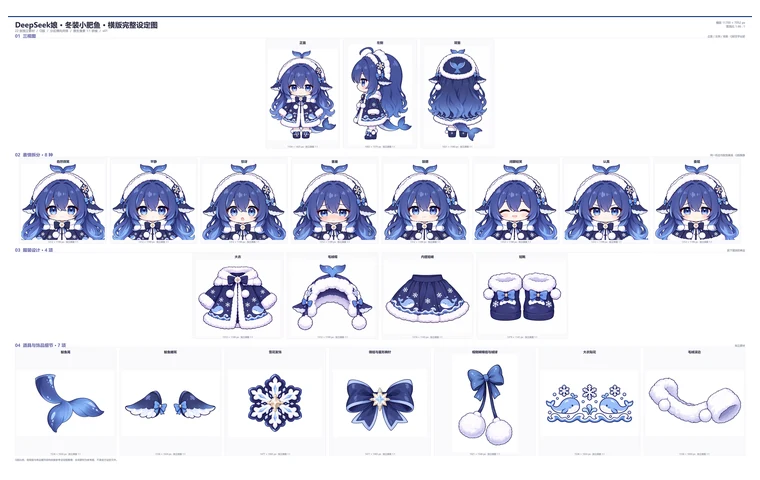</a> 
<strong><a href="设定图/12_DeepSeek娘_Q版冬装/冬装小肥鱼/">DeepSeek-chan</a></strong> 
12A · Chibi winter outfit, Winter Little Fish
</td>
</tr>
<tr>
<td width="50%" align="center" valign="top">
<a href="设定图/12_DeepSeek娘_Q版冬装/冬装小肥鱼2/完整设定图_浏览预览.jpg">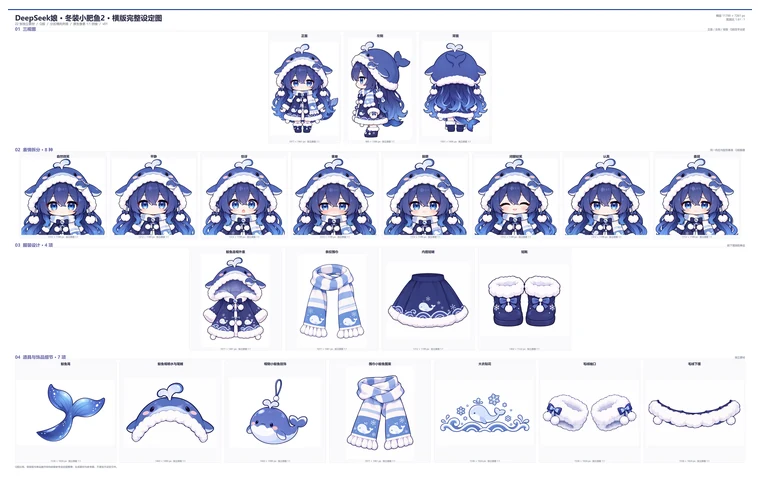</a> 
<strong><a href="设定图/12_DeepSeek娘_Q版冬装/冬装小肥鱼2/">DeepSeek-chan</a></strong> 
12B · Chibi winter outfit, Winter Little Fish 2
</td>
<td width="50%" align="center" valign="top">
<a href="设定图/13_GPT娘_Q版白紫龙娘/完整设定图_浏览预览.jpg">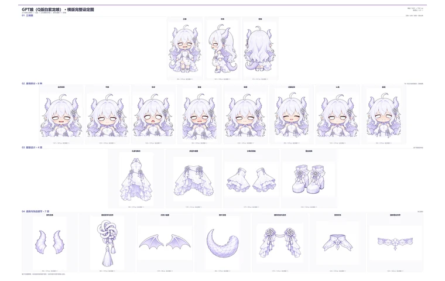</a> 
<strong><a href="设定图/13_GPT娘_Q版白紫龙娘/">GPT-chan</a></strong> 
13 · Chibi white-and-purple dragon girl
</td>
</tr>
<tr>
<td width="50%" align="center" valign="top">
<a href="设定图/14_DeepSeek娘_Claude工牌工作服/完整设定图_浏览预览.jpg">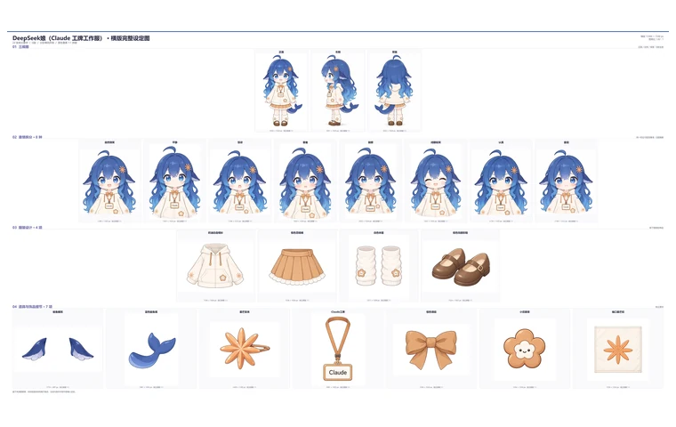</a> 
<strong><a href="设定图/14_DeepSeek娘_Claude工牌工作服/">DeepSeek-chan</a></strong> 
14 · Workwear with a Claude badge
</td>
<td width="50%" align="center" valign="top">
<a href="设定图/15_MiMo兔娘_甶丶_机能外套/完整设定图_浏览预览.jpg">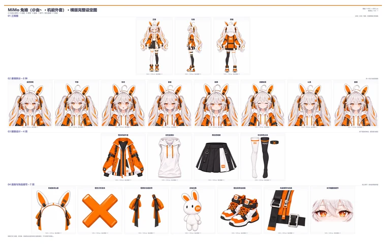</a> 
<strong><a href="设定图/15_MiMo兔娘_甶丶_机能外套/">MiMo Bunny-chan</a></strong> 
15 · Techwear jacket · @甶丶
</td>
</tr>
<tr>
<td width="50%" align="center" valign="top">
<a href="设定图/16_MiMo兔娘_Immyxxr_女仆装/完整设定图_浏览预览.jpg">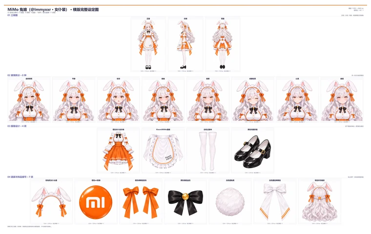</a> 
<strong><a href="设定图/16_MiMo兔娘_Immyxxr_女仆装/">MiMo Bunny-chan</a></strong> 
16 · Maid outfit · @Immyxxr
</td>
<td width="50%" align="center" valign="top">
<a href="设定图/17_LongCat娘_美团龙猫_现代外套/完整设定图_浏览预览.jpg">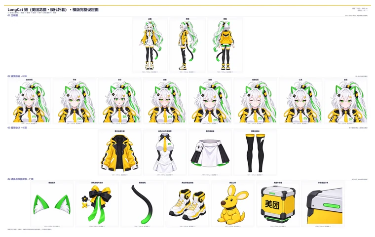</a> 
<strong><a href="设定图/17_LongCat娘_美团龙猫_现代外套/">LongCat-chan</a></strong> 
17 · Modern coat · @甶丶
</td>
</tr>
<tr>
<td width="50%" align="center" valign="top">
<a href="设定图/18_Mistral娘_法棍猫猫/完整设定图_浏览预览.jpg">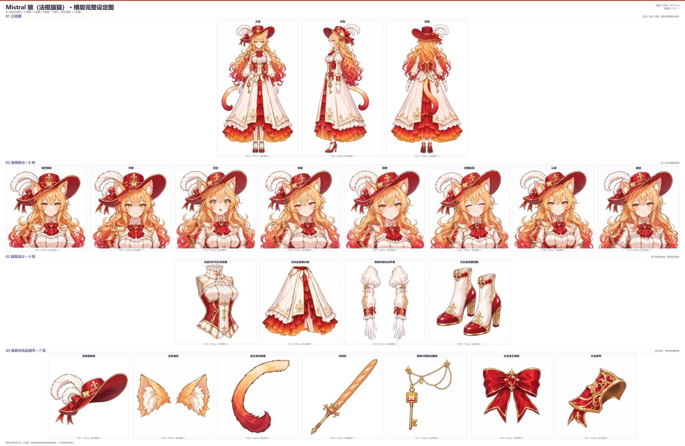</a> 
<strong><a href="设定图/18_Mistral娘_法棍猫猫/">Mistral-chan</a></strong> 
18 · Baguette catgirl
</td>
<td width="50%" align="center" valign="top">
<a href="设定图/19_Muse娘_Meta_AI/完整设定图_浏览预览.jpg">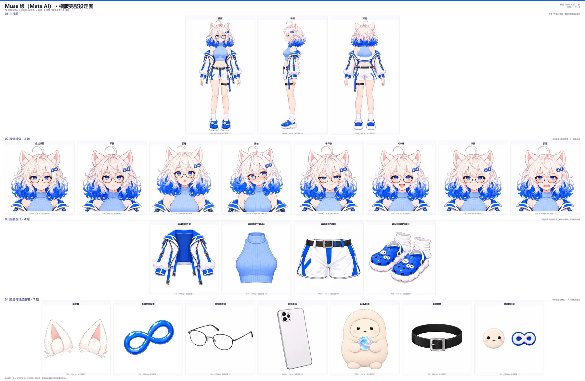</a> 
<strong><a href="设定图/19_Muse娘_Meta_AI/">Muse-chan</a></strong> 
19 · Meta AI
</td>
</tr>
</table>

## Star History

<picture>
  <source media="(prefers-color-scheme: dark)" srcset="docs/star-history-dark.svg">
  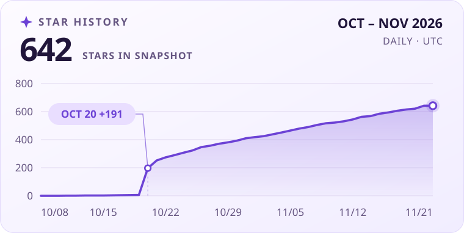
</picture>

The curve tracks cumulative stars by UTC date through November 21, 2026. October 20 had the most stars in a single day, with 191.

The snapshot includes 642 timestamped stars, matching the repository total at collection time. The curve counts stars still present when the snapshot was taken and shows the last day up to that time. [Daily data](docs/star-history.json) · [GitHub stargazers API](https://docs.github.com/en/rest/activity/starring#list-stargazers)

Thanks to @scarletkc for sharing the collection on X and helping correct the source credits. [X post](https://x.com/ScarletKc/status/2112406550186967218) · [Issue #7](https://github.com/lmy414/ai-chan-sheets/issues/7)

## Assets and Workflow

The original Qwen artwork shows only the front view. The image model inferred the side and back views from the visible design. For entries with an existing turnaround, each view used its corresponding source image as a reference. New expressions and hidden details were also inferred.

[Qwen original artwork](参考原图/05_通义千问娘_Qwen/原图_立绘_全身.jpg) · [Qwen sheet by section](设定图/05_通义千问娘_Qwen/便于查看/) · [Full-resolution tiles](设定图/05_通义千问娘_Qwen/原图切片/)

Each sheet assembles 22 assets. These include three character views, eight expressions, four outfit assets, and seven props and accessories. Each asset is placed at its original pixel size and verified byte for byte after assembly. The repository includes a web preview, images of individual sections, and four full-resolution tiles per sheet. The full-size masters are kept in the production workspace. Entries 13–19 also include the individual assets needed to rebuild their masters with the scripts.

[Original reference artwork](参考原图/) · [Production workflow (Chinese)](docs/生图流程.md) · [Assembly, tiling, and verification scripts](scripts/README.md)

Sheet specifications

| Entry | Character | Brand | Assets | Master dimensions (px) | Aspect ratio |
| --- | --- | --- | ---: | --- | --- |
| 01 | [Zhipu GLM-chan (wide-eared fox girl)](设定图/01_智谱GLM娘_阔耳狐娘/) | Zhipu AI / GLM | 22 | 13,366 × 7,572 | 1.77 : 1 |
| 02 | [GPT-chan (white dragon girl)](设定图/02_GPT娘_白龙娘/) | OpenAI | 22 | 14,388 × 8,152 | 1.77 : 1 |
| 03 | [DeepSeek-chan (whale girl)](设定图/03_DeepSeek娘_鲸鱼娘/) | DeepSeek | 22 | 11,700 × 8,008 | 1.46 : 1 |
| 04 | [ERNIE Bot-chan (blue-haired wheelchair user)](设定图/04_文心一言娘/) | Baidu | 22 | 11,700 × 7,956 | 1.47 : 1 |
| 05 | [Qwen-chan](设定图/05_通义千问娘_Qwen/) | Alibaba | 22 | 15,536 × 7,954 | 1.95 : 1 |
| 06 | [Kimi-chan](设定图/06_Kimi娘_Moonshot/) | Moonshot AI | 22 | 14,829 × 7,655 | 1.94 : 1 |
| 07 | [Doubao Seed-chan (high purple ponytail)](设定图/07_豆包Seed娘/) | ByteDance | 22 | 11,556 × 7,956 | 1.45 : 1 |
| 08 | [MiniMax-chan (Hailuo AI)](设定图/08_MiniMax娘_海螺AI/) | MiniMax | 22 | 12,652 × 7,935 | 1.59 : 1 |
| 09 | [Grok-chan (blonde vampire)](设定图/09_Grok娘_xAI/) | xAI | 22 | 14,619 × 7,953 | 1.84 : 1 |
| 10 | [Gemini-chan (four-point stars and cat ears)](设定图/10_Gemini娘/) | Google | 22 | 16,152 × 7,648 | 2.11 : 1 |
| 11 | [Claude-chan (orange hair and chrysanthemum motifs)](设定图/11_Claude娘_Anthropic/) | Anthropic | 22 | 10,596 × 7,698 | 1.38 : 1 |
| 12 | [DeepSeek-chan (chibi winter outfits)](设定图/12_DeepSeek娘_Q版冬装/) | DeepSeek | 44 (2 sheets × 22) | 11,700 × 7,052 / 11,700 × 7,261 | 1.66 : 1 / 1.61 : 1 |
| 13 | [GPT-chan (chibi white-and-purple dragon girl)](设定图/13_GPT娘_Q版白紫龙娘/) | OpenAI | 22 | 12,001 × 7,981 | 1.50 : 1 |
| 14 | [DeepSeek-chan (workwear with a Claude badge)](设定图/14_DeepSeek娘_Claude工牌工作服/) | DeepSeek | 22 | 13,366 × 7,348 | 1.82 : 1 |
| 15 | [MiMo Bunny-chan (techwear jacket by @甶丶)](设定图/15_MiMo兔娘_甶丶_机能外套/) | Xiaomi / MiMo | 22 | 11,092 × 6,842 | 1.62 : 1 |
| 16 | [MiMo Bunny-chan (maid outfit by @Immyxxr)](设定图/16_MiMo兔娘_Immyxxr_女仆装/) | Xiaomi / MiMo | 22 | 11,092 × 6,842 | 1.62 : 1 |
| 17 | [LongCat-chan (modern coat by @甶丶)](设定图/17_LongCat娘_美团龙猫_现代外套/) | Meituan / LongCat | 22 | 11,092 × 6,842 | 1.62 : 1 |
| 18 | [Mistral-chan (baguette catgirl)](设定图/18_Mistral娘_法棍猫猫/) | Mistral AI | 22 | 13,348 × 8,712 | 1.53 : 1 |
| 19 | [Muse-chan](设定图/19_Muse娘_Meta_AI/) | Meta AI / Muse | 22 | 13,348 × 8,712 | 1.53 : 1 |

Entry 12 includes two sheets with 22 assets each. [Winter Little Fish](设定图/12_DeepSeek娘_Q版冬装/冬装小肥鱼/) · [Winter Little Fish 2](设定图/12_DeepSeek娘_Q版冬装/冬装小肥鱼2/)

## Credits and License

Most of the original character designs and illustrations come from ZipZipPipe (胖次狐). [Bilibili profile](https://space.bilibili.com/4168597)

The original artists for entries 12–14 are uncredited on the source pages. Entries 15 and 17 credit @甶丶, and entry 16 credits @Immyxxr. The work page for entry 19 credits its artwork to Bilibili user 识知不失智.

This repository's additions are licensed under CC BY-NC-SA 4.0. The license requires attribution and noncommercial use, with shared adaptations under the same terms. The original artwork remains subject to its respective rights and permissions. [License](LICENSE) · [Rights and permissions by entry (Chinese)](版权与授权.md)
