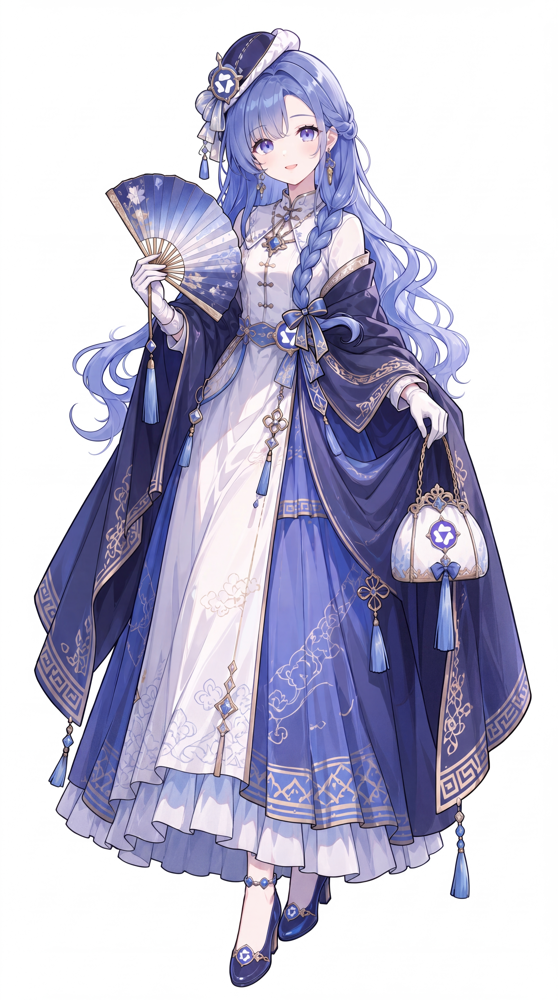
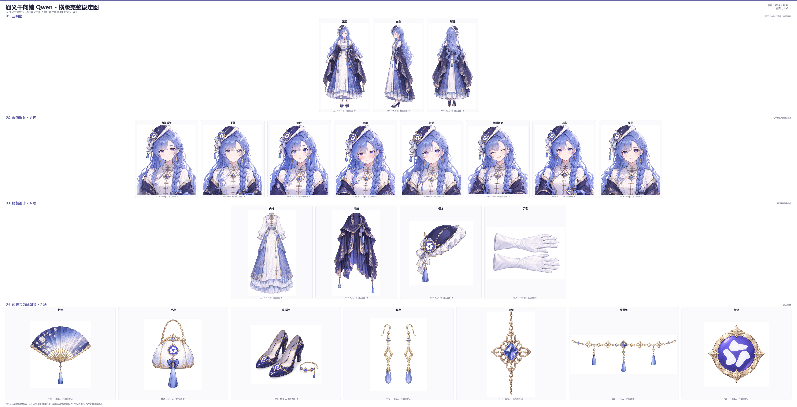
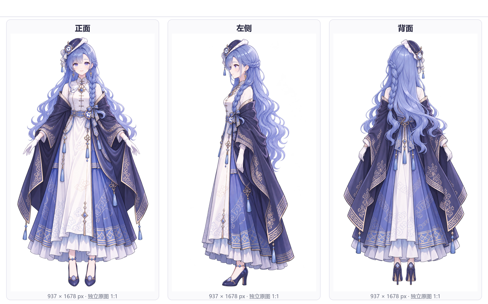
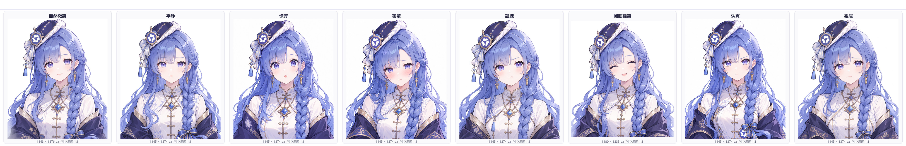
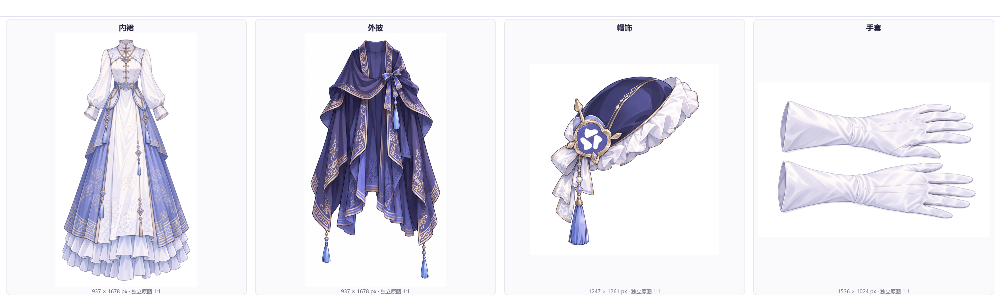
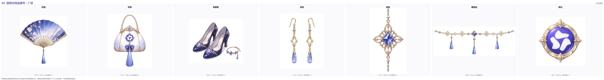

# AI 娘 · 横版完整设定图补全

把 AI 娘角色立绘逐张拆解成三视图、表情、服装与道具细节等独立素材。
原图只有正面的角色，用本机图像模型推定侧面与背面。原图已有侧背面的角色，以已有视图为依据。
各素材按原生像素 1:1 拼成一张横版完整设定图。

角色形象与设定主要来自 ZipZipPipe；第 12、13、14 条的来源作者未标注，见[版权与授权](版权与授权.md)。本仓库做的是设定图补全。

## 一张参考图能补出什么

以通义千问娘 Qwen 为例。左边是原作者的原始立绘，右边是补全后的横版完整设定图。

<table>
<tr>
<td width="50%">

**原作者原始立绘（唯一输入）**



</td>
<td width="50%">

**补全后的横版完整设定图**



</td>
</tr>
</table>

## 各个部件的说明图

设定板分四个区，横向排开。下面是 Qwen 的四个分区，其余角色在各角色目录的 `便于查看/` 下。

### 01 三视图：正面、左侧、背面

原图只有正面。左侧面与背面依据可见结构推定补全，包括被遮挡的裙片连接、外披内侧与鞋跟。



### 02 表情拆分：8 种

自然微笑、平静、惊讶、害羞、鼓腮、闭眼轻笑、认真、委屈，共 8 张，同一机位与脸型基准。



### 03 服装设计：4 项

把角色身上的服装拆成脱下摆放的单品，便于看清剪裁、层次与纹样。



### 04 道具与饰品细节：7 项

立绘上被手遮挡或过小的配件，逐个放大成独立素材。



## 原图切片：分区 1:1 原像素

`便于查看/` 里的 JPG 是为了任何看图器都能打开而缩到长边 4000 的预览。
每个角色目录下的 `原图切片/` 保留同一分区在母版上的原始像素，不缩放、不重采样，
适合直接当描线底图或细节参考。四个分区各一张 PNG：

| 文件 | 内容 |
|---|---|
| `横版完整设定图_01_三视图_原图.png` | 正面 / 左侧 / 背面 |
| `横版完整设定图_02_表情_原图.png` | 8 种表情 |
| `横版完整设定图_03_服装_原图.png` | 4 件服装单品 |
| `横版完整设定图_04_道具细节_原图.png` | 7 项道具与饰品 |

裁切范围与 `scripts/make_viewable.py` 完全一致，只是去掉缩放；生成脚本见
[`scripts/make_native_slices.py`](scripts/make_native_slices.py)。

## 生图流程

```
 原始参考图（有多个视图时按需裁切）
        │
        │  ① 逐张辨认：身份锚点、配色、服装层次、被遮挡的配件
        ▼
 制作清单.json（22 条任务）
        │
        │  ② 为每条任务写提示词，写明保留什么、修改什么、本张只画什么
        ▼
 提示词/*.json（22 条）
        │
        │  ③ 逐条调用本机图像模型，原立绘作为参考图传入
        │     模型 gpt-image-2.5-sunburst
        │     三视图 1536x2560，表情与道具 1536x1536
        │     质量 high，细小徽记与文字标识用 xhigh
        ▼
 01_三视图/ 02_表情/ 03_服装/ 04_道具细节/
        │   22 张独立素材 + 22 条生成记录
        │
        │  ④ 逐张目检：身份是否走形、左右是否镜像、标识文字是否正确
        │     不合格的另存 v02 重生成，v01 记录保留
        ▼
 scripts/compose_landscape.py
        │   分区横向并排，每分区一行，行内素材从左到右
        │   原生像素 1:1 粘贴，不缩放、不裁切，透明像素合成白底
        ▼
 05_横版设定板/  *_原像素.png（本地母版，不入库）
                 *_浏览预览.jpg
                 拼接布局与素材索引.json（每条素材的坐标与校验结果）
        │
        │  ⑤ 独立核验：从磁盘重算，不采信拼接脚本的自述
        ▼
 scripts/verify_board.py  → 逐字节比对 22/22，零重叠、零越界、零缩放
        │
        │  ⑥ 生成便于查看的小尺寸图
        ▼
 06_便于查看/  全板总览 + 4 张分区查看图
```

脚本在 [`scripts/`](scripts/README.md)，完整流程与故障处理见 [`docs/生图流程.md`](docs/生图流程.md)。

## 已完成的角色

| # | 角色 | 对应品牌 | 素材 | 横版母版尺寸 | 宽高比 | 设定图 |
|---|---|---|---|---|---|---|
| 01 | 智谱 GLM 娘（阔耳狐娘） | 智谱 / GLM | 22 | 13366 × 7572 | 1.77 : 1 | [查看](设定图/01_智谱GLM娘_阔耳狐娘/) |
| 02 | GPT 娘（白龙娘） | OpenAI | 22 | 14388 × 8152 | 1.77 : 1 | [查看](设定图/02_GPT娘_白龙娘/) |
| 03 | DeepSeek 娘（鲸鱼娘） | DeepSeek | 22 | 11700 × 8008 | 1.46 : 1 | [查看](设定图/03_DeepSeek娘_鲸鱼娘/) |
| 04 | 文心一言娘（蓝发轮椅少女） | 百度 | 22 | 11700 × 7956 | 1.47 : 1 | [查看](设定图/04_文心一言娘/) |
| 05 | 通义千问娘 Qwen | 阿里 | 22 | 15536 × 7954 | 1.95 : 1 | [查看](设定图/05_通义千问娘_Qwen/) |
| 06 | Kimi 娘 | 月之暗面 Moonshot | 22 | 14829 × 7655 | 1.94 : 1 | [查看](设定图/06_Kimi娘_Moonshot/) |
| 07 | 豆包 Seed 娘（紫发高马尾） | 字节跳动 | 22 | 11556 × 7956 | 1.45 : 1 | [查看](设定图/07_豆包Seed娘/) |
| 08 | MiniMax 娘（海螺 AI） | MiniMax | 22 | 12652 × 7935 | 1.59 : 1 | [查看](设定图/08_MiniMax娘_海螺AI/) |
| 09 | Grok 娘（金发吸血鬼） | xAI | 22 | 14619 × 7953 | 1.84 : 1 | [查看](设定图/09_Grok娘_xAI/) |
| 10 | Gemini 娘（四角星猫耳） | Google | 22 | 16152 × 7648 | 2.11 : 1 | [查看](设定图/10_Gemini娘/) |
| 11 | Claude 娘（橘发与菊花纹） | Anthropic | 22 | 10596 × 7698 | 1.38 : 1 | [查看](设定图/11_Claude娘_Anthropic/) |
| 12 | DeepSeek 娘（Q版冬装） | DeepSeek | 44（2 套 × 22） | 11700 × 7052 / 11700 × 7261 | 1.66 : 1 / 1.61 : 1 | [查看](设定图/12_DeepSeek娘_Q版冬装/) |
| 13 | GPT 娘（Q 版白紫龙娘） | OpenAI | 22 | 12001 × 7981 | 1.50 : 1 | [查看](设定图/13_GPT娘_Q版白紫龙娘/) |
| 14 | DeepSeek 娘（Claude 工牌工作服） | DeepSeek | 22 | 13366 × 7348 | 1.82 : 1 | [查看](设定图/14_DeepSeek娘_Claude工牌工作服/) |

### 12 DeepSeek 娘（Q版冬装）

两套 Q 版冬装，各 22 张素材、各一张横版设定板，合并为一个角色条目。

| 套 | 素材 | 横版母版尺寸 | 宽高比 | 设定图 |
|---|---|---|---|---|
| 冬装小肥鱼 | 22 | 11700 × 7052 | 1.66 : 1 | [查看](设定图/12_DeepSeek娘_Q版冬装/冬装小肥鱼/) |
| 冬装小肥鱼2 | 22 | 11700 × 7261 | 1.61 : 1 | [查看](设定图/12_DeepSeek娘_Q版冬装/冬装小肥鱼2/) |

两套来源页均未标注作者，授权记录为 unknown；见[版权与授权](版权与授权.md)。

第 13 条的来源图已有三视图，生成时分别参考对应视图。第 14 条只有正面与服装拆解，
侧面和背面为推定。两条来源页的作者和授权均未标注，详情见各角色目录。

每个角色 22 张素材，含 3 张三视图、8 张表情、4 件服装、7 项道具饰品，全部通过逐字节核验；
另有 4 张分区原图切片，保留母版上的原始像素。第 12 条为两套冬装，共 44 张素材、两张母版。

横版母版是 1:1 拼接的原像素文件，因此不入库，规则见 `.gitignore`。仓库保留浏览预览、
分区查看图和原图切片。第 13、14 条也保留独立素材，可以使用 `scripts/compose_landscape.py`
重建母版。旧条目的独立素材保存在本地工程，重建时需要先提供相应素材。

## 目录结构

```
ZipZipPipe/
├── README.md                 本文件
├── 版权与授权.md              原作者与出处链接
├── LICENSE                   许可范围声明
├── docs/
│   └── 生图流程.md            工作流详述与故障速查
├── scripts/                  完整工作流脚本，路径可配置
├── 参考原图/<角色>/           原作者原始作品；裁切/ 为局部细节裁切
└── 设定图/<角色>/
    ├── 制作清单.json          22 条任务清单
    ├── 提示词/*.json          22 条完整提示词
    ├── 生成记录/*.json        每张的模型、质量、尺寸、耗时、sha256
    ├── 01_三视图/ 等          第 13、14 条的 22 张独立素材
    ├── 拼接布局与素材索引.json   每条素材在板上的坐标与校验结果
    ├── 完整设定图_浏览预览.jpg
    ├── 原图切片/*.png          4 个分区的 1:1 原像素切片
    └── 便于查看/              全板总览 + 4 张分区查看图
```

第 12 条是合并条目，内部按套分为 `冬装小肥鱼/` 与 `冬装小肥鱼2/`，每套都保持上面的标准结构。

## Star 曲线

2026 年 10 月 20 日 [X 上的这条推文](https://x.com/ScarletKc/status/2112406550186967218)发布后，Star 一天涨了 195。下图是按 UTC 日期聚合的累计
Star 数，数据来自 GitHub REST API 的 stargazers 接口：


截至 2026-10-22 共 265 Stars。

特别感谢 [@scarletkc](https://github.com/scarletkc) 在 X 上[发推分享](https://x.com/ScarletKc/status/2112406550186967218)了这个项目，那天的 Star 基本都是这条推带来的；也谢谢他在 [#7](https://github.com/lmy414/ai-chan-sheets/issues/7) 里帮忙纠正了来源数据 🙏

---

角色设定主要来自 [ZipZipPipe](https://space.bilibili.com/4168597)，第 12、13、14 条的来源与授权见 [版权与授权](版权与授权.md)。
