# AI 娘设定图集

把 AI 娘立绘整理成横版设定板。一张板上可以看全角色的三视图、表情、服装和道具细节。

[角色图鉴](#角色图鉴) · [Star 曲线](#star-曲线) · [素材与制作](#素材与制作) · [版权与授权](版权与授权.md)

## 角色图鉴

收录 17 个条目、18 张设定板。点图片看大图，点角色名进入目录查找原像素切片和制作记录。

<table width="100%">
<tr>
<td width="50%" align="center" valign="top">
<a href="设定图/01_智谱GLM娘_阔耳狐娘/完整设定图_浏览预览.jpg">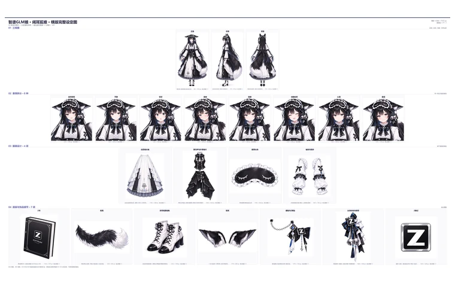</a> 
<strong><a href="设定图/01_智谱GLM娘_阔耳狐娘/">智谱 GLM 娘</a></strong> 
01 · 阔耳狐娘
</td>
<td width="50%" align="center" valign="top">
<a href="设定图/02_GPT娘_白龙娘/完整设定图_浏览预览.jpg">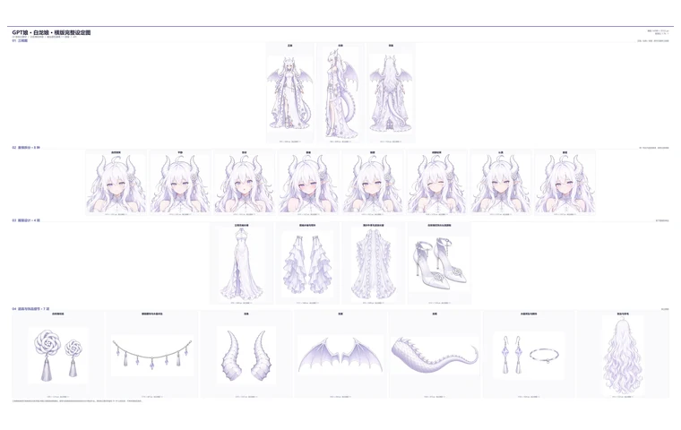</a> 
<strong><a href="设定图/02_GPT娘_白龙娘/">GPT 娘</a></strong> 
02 · 白龙娘
</td>
</tr>
<tr>
<td width="50%" align="center" valign="top">
<a href="设定图/03_DeepSeek娘_鲸鱼娘/完整设定图_浏览预览.jpg">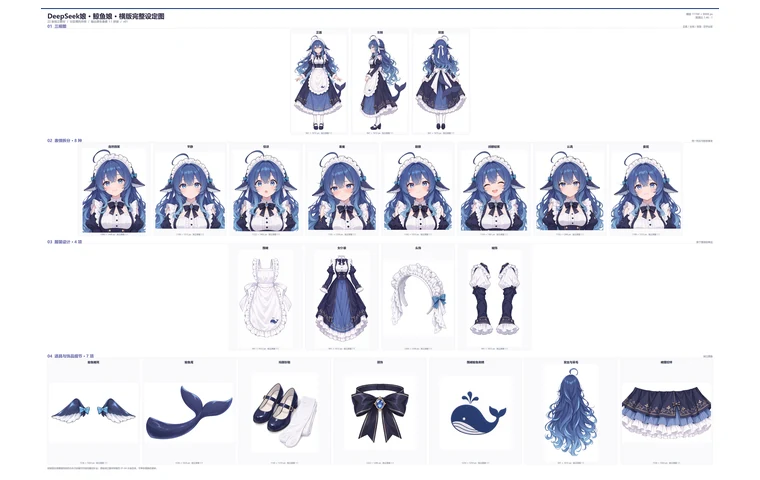</a> 
<strong><a href="设定图/03_DeepSeek娘_鲸鱼娘/">DeepSeek 娘</a></strong> 
03 · 鲸鱼娘
</td>
<td width="50%" align="center" valign="top">
<a href="设定图/04_文心一言娘/完整设定图_浏览预览.jpg">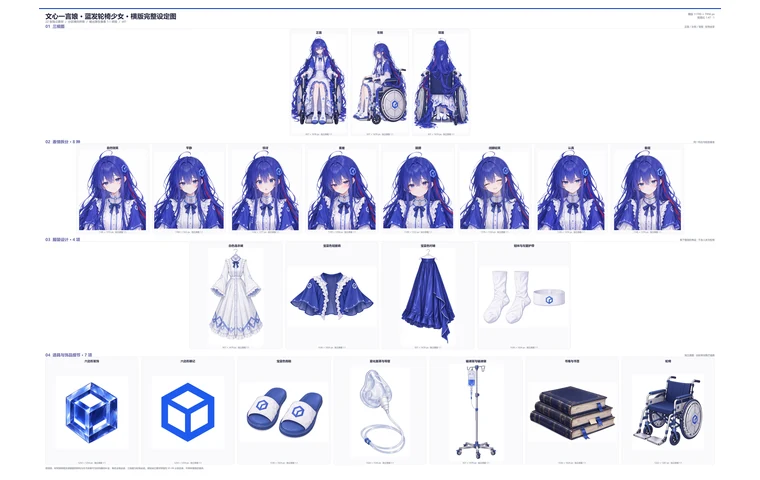</a> 
<strong><a href="设定图/04_文心一言娘/">文心一言娘</a></strong> 
04 · 蓝发轮椅少女
</td>
</tr>
<tr>
<td width="50%" align="center" valign="top">
<a href="设定图/05_通义千问娘_Qwen/完整设定图_浏览预览.jpg">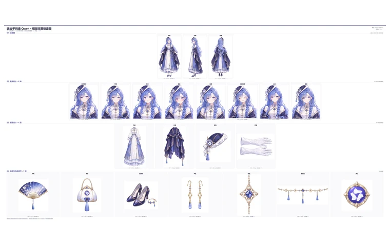</a> 
<strong><a href="设定图/05_通义千问娘_Qwen/">通义千问娘</a></strong> 
05 · Qwen
</td>
<td width="50%" align="center" valign="top">
<a href="设定图/06_Kimi娘_Moonshot/完整设定图_浏览预览.jpg">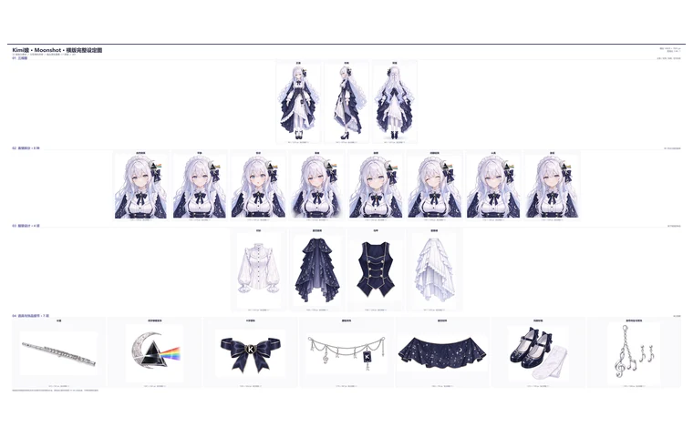</a> 
<strong><a href="设定图/06_Kimi娘_Moonshot/">Kimi 娘</a></strong> 
06 · Moonshot
</td>
</tr>
<tr>
<td width="50%" align="center" valign="top">
<a href="设定图/07_豆包Seed娘/完整设定图_浏览预览.jpg">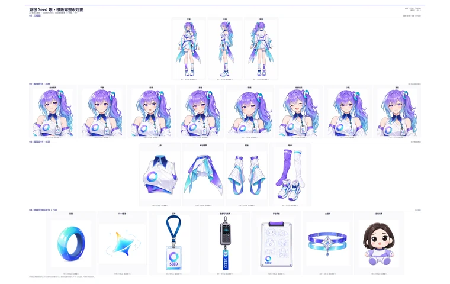</a> 
<strong><a href="设定图/07_豆包Seed娘/">豆包 Seed 娘</a></strong> 
07 · 紫发高马尾
</td>
<td width="50%" align="center" valign="top">
<a href="设定图/08_MiniMax娘_海螺AI/完整设定图_浏览预览.jpg">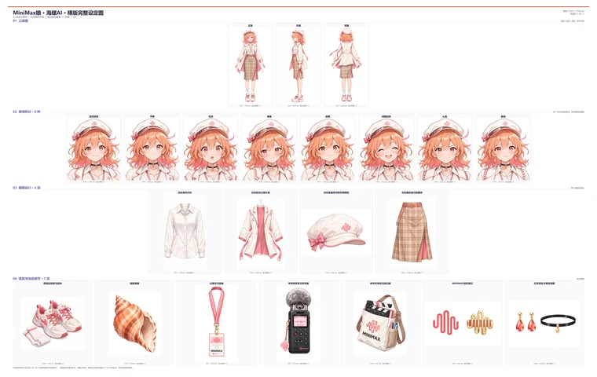</a> 
<strong><a href="设定图/08_MiniMax娘_海螺AI/">MiniMax 娘</a></strong> 
08 · 海螺 AI
</td>
</tr>
<tr>
<td width="50%" align="center" valign="top">
<a href="设定图/09_Grok娘_xAI/完整设定图_浏览预览.jpg">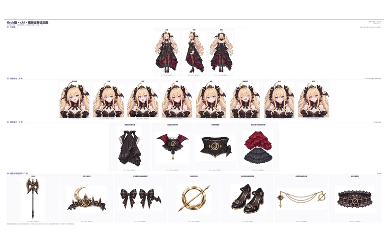</a> 
<strong><a href="设定图/09_Grok娘_xAI/">Grok 娘</a></strong> 
09 · 金发吸血鬼
</td>
<td width="50%" align="center" valign="top">
<a href="设定图/10_Gemini娘/完整设定图_浏览预览.jpg">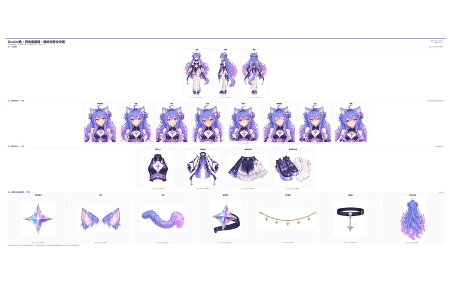</a> 
<strong><a href="设定图/10_Gemini娘/">Gemini 娘</a></strong> 
10 · 四角星猫耳
</td>
</tr>
<tr>
<td width="50%" align="center" valign="top">
<a href="设定图/11_Claude娘_Anthropic/完整设定图_浏览预览.jpg">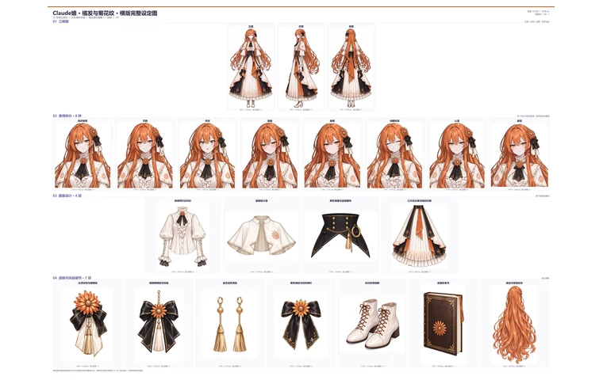</a> 
<strong><a href="设定图/11_Claude娘_Anthropic/">Claude 娘</a></strong> 
11 · 橘发与菊花纹
</td>
<td width="50%" align="center" valign="top">
<a href="设定图/12_DeepSeek娘_Q版冬装/冬装小肥鱼/完整设定图_浏览预览.jpg">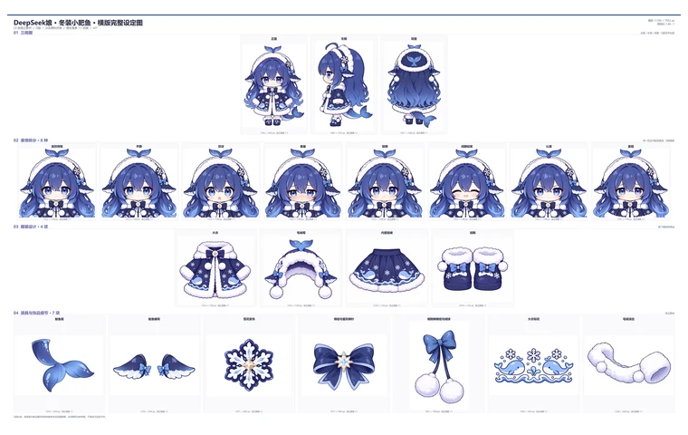</a> 
<strong><a href="设定图/12_DeepSeek娘_Q版冬装/冬装小肥鱼/">DeepSeek 娘</a></strong> 
12A · Q 版冬装 · 冬装小肥鱼
</td>
</tr>
<tr>
<td width="50%" align="center" valign="top">
<a href="设定图/12_DeepSeek娘_Q版冬装/冬装小肥鱼2/完整设定图_浏览预览.jpg">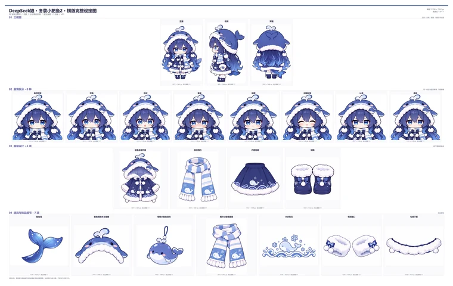</a> 
<strong><a href="设定图/12_DeepSeek娘_Q版冬装/冬装小肥鱼2/">DeepSeek 娘</a></strong> 
12B · Q 版冬装 · 冬装小肥鱼 2
</td>
<td width="50%" align="center" valign="top">
<a href="设定图/13_GPT娘_Q版白紫龙娘/完整设定图_浏览预览.jpg">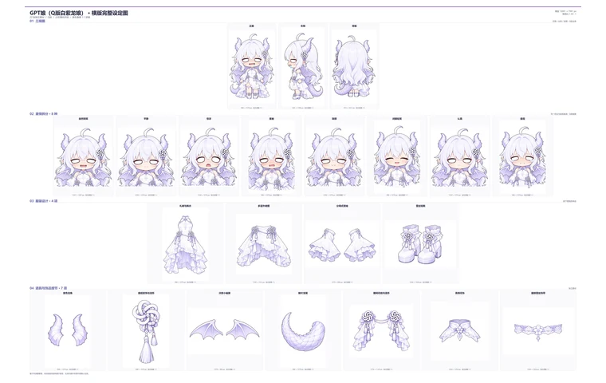</a> 
<strong><a href="设定图/13_GPT娘_Q版白紫龙娘/">GPT 娘</a></strong> 
13 · Q 版白紫龙娘
</td>
</tr>
<tr>
<td width="50%" align="center" valign="top">
<a href="设定图/14_DeepSeek娘_Claude工牌工作服/完整设定图_浏览预览.jpg">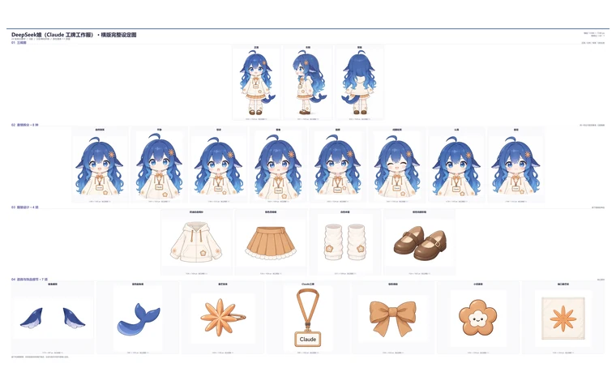</a> 
<strong><a href="设定图/14_DeepSeek娘_Claude工牌工作服/">DeepSeek 娘</a></strong> 
14 · Claude 工牌工作服
</td>
<td width="50%" align="center" valign="top">
<a href="设定图/15_MiMo兔娘_甶丶_机能外套/完整设定图_浏览预览.jpg">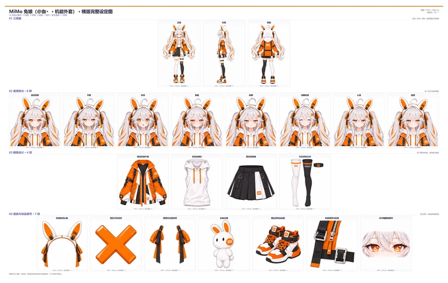</a> 
<strong><a href="设定图/15_MiMo兔娘_甶丶_机能外套/">MiMo 兔娘</a></strong> 
15 · 机能外套 · @甶丶
</td>
</tr>
<tr>
<td width="50%" align="center" valign="top">
<a href="设定图/16_MiMo兔娘_Immyxxr_女仆装/完整设定图_浏览预览.jpg">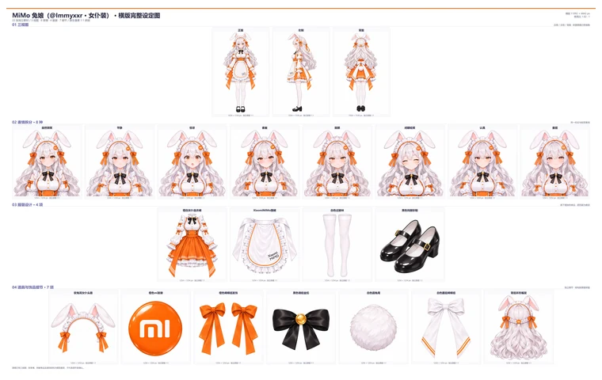</a> 
<strong><a href="设定图/16_MiMo兔娘_Immyxxr_女仆装/">MiMo 兔娘</a></strong> 
16 · 女仆装 · @Immyxxr
</td>
<td width="50%" align="center" valign="top">
<a href="设定图/17_LongCat娘_美团龙猫_现代外套/完整设定图_浏览预览.jpg">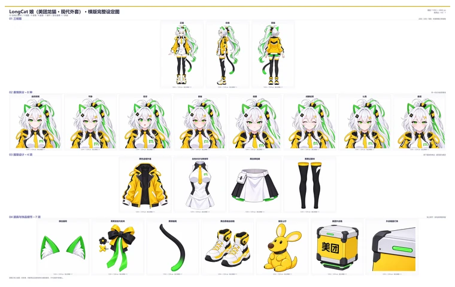</a> 
<strong><a href="设定图/17_LongCat娘_美团龙猫_现代外套/">LongCat 娘</a></strong> 
17 · 现代外套 · @甶丶
</td>
</tr>
</table>

## Star 曲线

<picture>
  <source media="(prefers-color-scheme: dark)" srcset="docs/star-history-dark.svg">
  
</picture>

曲线更新至 2026 年 11 月 10 日，按 UTC 日期累计。10 月 20 日增加 190 条，为这次快照中的最高单日增量。

[逐日数据](docs/star-history.json)来自 [GitHub 的 Star 列表接口](https://docs.github.com/en/rest/activity/starring#list-stargazers)。列表返回 518 条带时间戳的记录，同期仓库概览显示 517 Stars。曲线以列表为准，已取消的 Star 无法从列表还原。

感谢 [@scarletkc](https://github.com/scarletkc) 在 [X](https://x.com/ScarletKc/status/2112406550186967218) 分享图集，并在 [#7](https://github.com/lmy414/ai-chan-sheets/issues/7) 帮忙纠正来源记录。

## 素材与制作

以通义千问娘为例：原图只有正面，侧面和背面由图像模型根据可见结构推定。有现成三视图的条目会分别参考原图对应视角。新表情、隐藏面和不可见结构属于补全推定。

[Qwen 原始立绘](参考原图/05_通义千问娘_Qwen/原图_立绘_全身.jpg) · [四个分区的查看图](设定图/05_通义千问娘_Qwen/便于查看/) · [原像素切片](设定图/05_通义千问娘_Qwen/原图切片/)

每套设定板包含 22 张素材：3 张三视图、8 张表情、4 件服装和 7 项道具与饰品。素材按 1:1 原像素拼接，并逐字节核验。仓库保留浏览预览、分区查看图和 4 张原像素切片；全尺寸母版留在制作工程中。第 13 至 17 条另附独立素材，可用脚本重建母版。

[原始参考图目录](参考原图/) · [制作流程](docs/生图流程.md) · [拼板、切片与核验脚本](scripts/README.md)

展开查看各套设定板规格

| 编号 | 角色 | 对应品牌 | 素材 | 横版母版尺寸（像素） | 宽高比 |
| --- | --- | --- | ---: | --- | --- |
| 01 | [智谱 GLM 娘（阔耳狐娘）](设定图/01_智谱GLM娘_阔耳狐娘/) | 智谱 / GLM | 22 | 13,366 × 7572 | 1.77 : 1 |
| 02 | [GPT 娘（白龙娘）](设定图/02_GPT娘_白龙娘/) | OpenAI | 22 | 14,388 × 8152 | 1.77 : 1 |
| 03 | [DeepSeek 娘（鲸鱼娘）](设定图/03_DeepSeek娘_鲸鱼娘/) | DeepSeek | 22 | 11,700 × 8008 | 1.46 : 1 |
| 04 | [文心一言娘（蓝发轮椅少女）](设定图/04_文心一言娘/) | 百度 | 22 | 11,700 × 7956 | 1.47 : 1 |
| 05 | [通义千问娘 Qwen](设定图/05_通义千问娘_Qwen/) | 阿里 | 22 | 15,536 × 7954 | 1.95 : 1 |
| 06 | [Kimi 娘](设定图/06_Kimi娘_Moonshot/) | 月之暗面 Moonshot | 22 | 14,829 × 7655 | 1.94 : 1 |
| 07 | [豆包 Seed 娘（紫发高马尾）](设定图/07_豆包Seed娘/) | 字节跳动 | 22 | 11,556 × 7956 | 1.45 : 1 |
| 08 | [MiniMax 娘（海螺 AI）](设定图/08_MiniMax娘_海螺AI/) | MiniMax | 22 | 12,652 × 7935 | 1.59 : 1 |
| 09 | [Grok 娘（金发吸血鬼）](设定图/09_Grok娘_xAI/) | xAI | 22 | 14,619 × 7953 | 1.84 : 1 |
| 10 | [Gemini 娘（四角星猫耳）](设定图/10_Gemini娘/) | Google | 22 | 16,152 × 7648 | 2.11 : 1 |
| 11 | [Claude 娘（橘发与菊花纹）](设定图/11_Claude娘_Anthropic/) | Anthropic | 22 | 10,596 × 7698 | 1.38 : 1 |
| 12 | [DeepSeek 娘（Q版冬装）](设定图/12_DeepSeek娘_Q版冬装/) | DeepSeek | 44（2 套 × 22） | 11,700 × 7052 / 11,700 × 7261 | 1.66 : 1 / 1.61 : 1 |
| 13 | [GPT 娘（Q 版白紫龙娘）](设定图/13_GPT娘_Q版白紫龙娘/) | OpenAI | 22 | 12,001 × 7981 | 1.50 : 1 |
| 14 | [DeepSeek 娘（Claude 工牌工作服）](设定图/14_DeepSeek娘_Claude工牌工作服/) | DeepSeek | 22 | 13,366 × 7348 | 1.82 : 1 |
| 15 | [MiMo 兔娘（@甶丶 · 机能外套）](设定图/15_MiMo兔娘_甶丶_机能外套/) | 小米 / MiMo | 22 | 11,092 × 6842 | 1.62 : 1 |
| 16 | [MiMo 兔娘（@Immyxxr · 女仆装）](设定图/16_MiMo兔娘_Immyxxr_女仆装/) | 小米 / MiMo | 22 | 11,092 × 6842 | 1.62 : 1 |
| 17 | [LongCat 娘（美团龙猫 · 现代外套）](设定图/17_LongCat娘_美团龙猫_现代外套/) | 美团 / LongCat | 22 | 11,092 × 6842 | 1.62 : 1 |

第 12 条包括 [冬装小肥鱼](设定图/12_DeepSeek娘_Q版冬装/冬装小肥鱼/) 和 [冬装小肥鱼 2](设定图/12_DeepSeek娘_Q版冬装/冬装小肥鱼2/)，各 22 张素材。

## 出处与授权

角色形象与原始设定主要来自 [ZipZipPipe（胖次狐）](https://space.bilibili.com/4168597)。第 12 至 14 条的原作者未标注；第 15、17 条署名 @甶丶，第 16 条署名 @Immyxxr。

本仓库收录非商业设定图补全。各原作的权利状态和使用范围以[版权与授权记录](版权与授权.md)为准。
