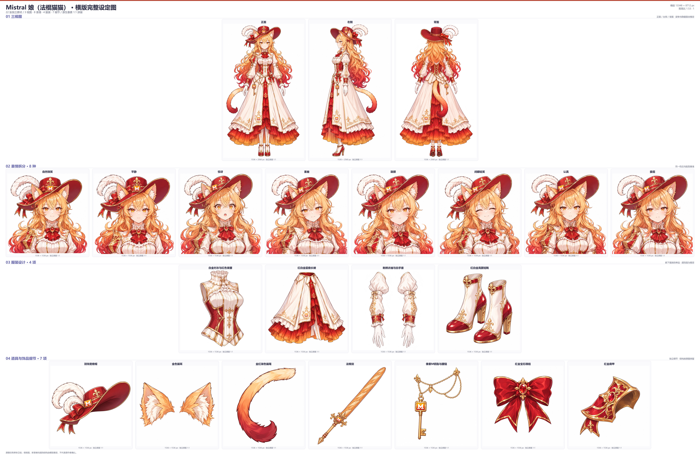

# Mistral 娘（法棍猫猫）

本套包含 22 张独立素材：3 张三视图、8 张表情、4 项服装和 7 项道具与饰品细节。横版母版为 13,348 × 8,712 像素。独立素材、提示词、生成记录、分区查看图和 4 张原像素切片均保存在本目录。

本次保留原图的金橙至深红渐色长发、琥珀色眼睛、猫耳猫尾、羽饰宽檐帽和红白金层叠长裙。法棍剑、像素 M 钥匙腰链、领结和单侧肩甲分别拆出细节。

原图只有单张立绘。标准正面姿势、左侧、背面、新表情，以及拆解单品的隐藏面和连接结构均含模型推定，不代表原作者确认的设定。三视图采用空手站姿，法棍剑单独收在道具分区。

全部素材经本机 Magpie 的 `/v1/images/edits` 接口绘制，质量为 `high`。三视图和前 2 张表情采用 `gpt-image-2.6-sunburst`，其余素材采用 `gpt-image-2.6-flare`。三视图请求 1536 × 2560 像素，其余素材请求 1536 × 1536 像素。生成记录分别保存请求参数、返回模型、实际尺寸、用量、耗时及输入输出哈希。

三视图、表情和多数单品同时参考原图与已检查的正面基准图，以保持服装和角色一致。`提示词/` 中的 `@A01_三视图_正面` 表示引用该任务的成品。猫尾重绘只使用原图的猫尾裁切。生成失败只重试同一图生图接口，不回退纯文生图。

背面帽冠、衣袖和猫尾经过定向修正。修正前的图片与生成记录保存在 `审图历史/`，采用的版本以当前生成记录和拼接索引为准。

## 来源与授权

- 原作者：[ZipZipPipe（胖次狐）](https://space.bilibili.com/4168597)。
- 原帖：[《AI 娘第二批，有 Seed（豆包底模）》第 4 张](https://www.bilibili.com/opus/1236803362705375305)。
- 本次输入：用户指定的本地收藏导出图，与原帖为同一张画。
- [来源原图、裁切与核对记录](../../参考原图/18_Mistral娘_法棍猫猫/)。
- 原图的具体许可尚未核实，记录为 `unknown`。仓库许可仅覆盖补全工作，不代替原图授权。

## 文件入口

- [三视图](01_三视图/)、[表情](02_表情/)、[服装](03_服装/)和[道具细节](04_道具细节/)。
- [分区查看图](便于查看/)和[原像素切片](原图切片/)。
- [制作清单](制作清单.json)、[提示词](提示词/)、[生成记录](生成记录/)和[拼接索引](拼接布局与素材索引.json)。
