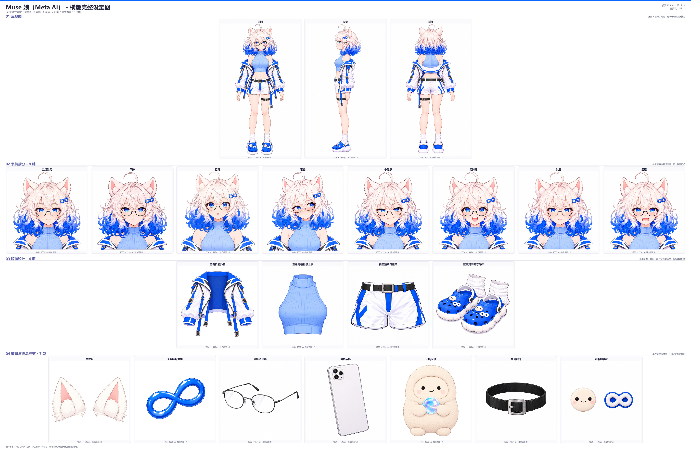

# Muse 娘（Meta AI）

设定板含 22 张独立素材，包括 3 张视图、8 张表情、4 项服装和 7 项道具与饰品。横版母版为 13,348 × 8,712 像素。母版可用 [拼板脚本](../../scripts/README.md) 从本目录的素材重建。

角色保留白蓝渐变发、羊驼耳、左侧 ∞ 发夹和细框圆眼镜。服装沿用蓝色高领针织上衣、白蓝机能外套、白蓝短裤、左腿环和蓝白洞洞鞋。Jolly 玩偶和自拍手机收在道具分区。

三视图采用空手中立站姿。笑眯眯、小得意和委屈表情参考已有立绘。左侧、背面、新增表情和拆解图的遮挡结构含模型推定。

## 生成与核验

素材逐张通过本机 Magpie 的 `/v1/images/edits` 生成，质量均为 `high`。三视图与前两张表情使用 `gpt-image-2.6-sunburst`，其余素材使用 `gpt-image-2.6-flare`。三视图为 1536 × 2560 像素，其他素材为 1536 × 1536 像素。

设定板按 1:1 原生像素拼接。可下载 4 张原像素切片，也可单独使用每张素材。[审图记录](审图记录.json) · [核验报告](核验报告.json)

## 文件入口

- [三视图](01_三视图/) · [表情](02_表情/) · [服装](03_服装/) · [道具与饰品](04_道具细节/)
- [分区查看图](便于查看/) · [原像素切片](原图切片/)
- [制作清单](制作清单.json) · [提示词](提示词/) · [生成记录](生成记录/) · [拼接索引](拼接布局与素材索引.json)

## 出处与授权

作品页图片署名为 B 站「识知不失智」。原图许可范围记录为 `unknown`。宣传立绘、全身图、表情和两张附件的出处及哈希见参考原图目录。[蓝色大肥鱼作品页](https://xn--pssy23gqgbz2d718b.com/works/other202611130007.html) · [参考原图](../../参考原图/19_Muse娘_Meta_AI/) · [版权与授权](../../版权与授权.md)
